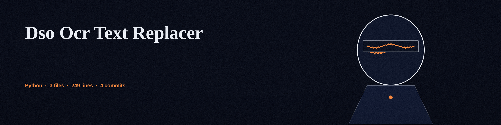

# dso-ocr-text-replacer
Replaces text recognized by OCR (Optical Character Recognition) in images or PDFs with placeholder text or other configurable values. - Focused on Tools for sanitizing and obfuscating sensitive data within text files and structured data formats

## Install
`git clone https://github.com/ShadowGuardAI/dso-ocr-text-replacer`

## Usage
`./dso-ocr-text-replacer [params]`

## Parameters
- `-h`: Show help message and exit
- `-o`: The output image or PDF file. Required unless `--in-place` is given. An output path that resolves to the input file is refused at exit 1.
- `--in-place`: Overwrite the input file in place. Only applies when `-o` is not given. Without `-o` or `--in-place`, the run exits 1 and writes nothing.
- `-r`: The text drawn at each matched OCR word box in place of the matched word. Words are located with the OCR word boxes, the matched box is cleared, and this text is drawn at that box. The rest of the page is left unchanged.
- `-l`: The language to use for OCR. Defaults to eng
- `-d`: The DPI to use when converting PDFs to images. Defaults to 200.
- `-p`: A regular expression pattern to match text to be replaced. If not provided, all OCR words are replaced. An invalid pattern exits 1.
- `-f`: Use Faker to generate a replacement value for each matched word, drawn at that word box. Overrides `-r`.
- `--faker_locale`: Locale to use for Faker (e.g., en_US)

For PDF input, the per page images are assembled into a single PDF at the `-o` path. A corrupt input, an invalid pattern, or a run where no OCR word matches exits 1 and writes no output.

## License
Copyright (c) ShadowGuardAI
